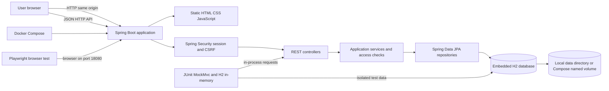

# Matriz - Technical Architecture

## Status and scope

This document describes the implementation currently in the repository. Matriz is a single deployable Spring Boot application (a modular monolith), with a browser interface, HTTP API, application services, and H2 persistence. The access policy, task assignments, and comments are implementation-exercise extensions; they are not confirmed production requirements.

The functional MVP is project and task management: create, consult, update, and remove projects and tasks; track task status; search and filter tasks; and view task counts. The implementation also contains session authentication and project-scoped roles, comments, and task assignments to support the exercises. See [requirements](requirements.md), [user stories](user-stories.md), and [constraints](constraints.md) for product scope and decisions that remain unconfirmed.

## System context and component diagram

The browser UI is served by Spring Boot from `src/main/resources/static`. There is no separate frontend server or runtime service. The browser calls the API on the same origin by default. Controllers and domain/application code are in the `com.matriz` Java packages; persistence mappings are JPA entities and repositories.

## Runtime components and responsibilities

| Component | Implementation | Responsibility |
|---|---|---|
| Browser UI | Plain HTML, CSS, and JavaScript under `src/main/resources/static` | Sign-in, project and task views, task filters, assignment and comment interactions. |
| HTTP API | Spring MVC controllers under `com.matriz.api` | Expose authentication, health, project, task, assignment, and comment endpoints. |
| Security | Spring Security; server-side HTTP session | Authenticate demo users, enforce CSRF on state-changing requests, and protect API access. |
| Application logic | Services under `com.matriz.service` | Validate operations, apply project-scoped access rules, and coordinate persistence. |
| Persistence | Spring Data JPA repositories and entities under `com.matriz.repository` and `com.matriz.domain` | Read and write projects, tasks, users, memberships, assignments, and comments. |
| Database | Embedded H2 | File-backed for local/Compose execution; in-memory for integration and E2E tests. |

The project targets Java 25, Spring Boot 4.0.9, and Gradle Wrapper 9.8.2. H2 schema initialization is in `src/main/resources/schema.sql`; Hibernate validates the mapped schema at startup. `DemoDataInitializer` creates missing fictitious demo records and does not reset user data on subsequent starts.

## Request and persistence flow

1. The browser loads the static UI from the Spring Boot application.
2. The browser obtains a CSRF token from `GET /auth/csrf`, then submits credentials to `POST /auth/login`.
3. Spring Security associates the authenticated identity with a server-side session and issues an HttpOnly `JSESSIONID` cookie.
4. The browser sends same-origin JSON requests to project/task controllers, including the session cookie and CSRF token for state-changing requests.
5. Controllers call application services. Services validate input and check the authenticated user's project membership and role before using repositories.
6. Spring Data JPA persists changes to H2. The API returns JSON responses or structured errors to the browser.

The session cookie is HttpOnly and SameSite=Lax. The Secure attribute is controlled by `MATRIZ_SESSION_COOKIE_SECURE` and defaults to `false` for local HTTP. Passwords are stored as BCrypt hashes. For endpoint definitions and request/response schemas, see the [OpenAPI contract](../openapi.yaml).

## Data and persistence

The primary records are projects and tasks. A task belongs to one project and has a status (`TODO`, `IN_PROGRESS`, `DONE`) and priority (`LOW`, `MEDIUM`, `HIGH`). The exercise extensions add users, project memberships, task assignments, and task comments. The detailed data model is in [database.md](database.md).

- Local `bootRun`: file-backed database under the ignored `data/` directory, configured by `MATRIZ_DB_URL`.
- Docker Compose: embedded H2 database in a named `matriz-data` volume mounted at `/app/data`.
- Integration tests: in-memory H2 database; test mutations are isolated from local data.
- Playwright E2E: separate application process on port `18080`, with an in-memory H2 database and fictitious test credentials.

There is no separate database container or external runtime service. Do not remove the local `data/` directory or Compose volume unless intentionally deleting that environment's data.

## Access policy and scope boundaries

For the implementation exercise, the approved policy is project-scoped:

- users can access only projects to which they belong;
- managers can update/remove their projects, create/remove tasks, and manage task assignments;
- project members can consult projects and tasks, update tasks, and add/list comments;
- only active members of a project can be assigned to that project's tasks.

The application checks access on server-side API operations, including direct resource-ID requests. This policy supports the exercise and is not an approved production security policy. Production authentication, authorization, privacy, backup/recovery, and deployment requirements remain to be confirmed. See [constraints.md](constraints.md).

## Build, test, and deployment

- Local application: `./gradlew bootRun` with Java 25 and environment variables from `.env`.
- Backend tests: `./gradlew --no-daemon clean test`; JUnit and MockMvc use isolated H2.
- Frontend auth regression tests: `node --experimental-default-type=module --test src/test/js/auth.test.mjs`.
- Browser E2E: `npm ci`, `npx playwright install chromium`, then `npm run test:e2e`.
- Container run: `docker compose config --quiet`, `docker compose build`, then `docker compose up -d`.
- CI: `.github/workflows/ci.yml` runs verification before the dependent Docker image build. It does not publish an image.

The README contains complete setup, environment, test, and Compose commands. The OpenAPI document is the HTTP contract; no separate API server or generated documentation site is configured.

## External dependencies and open decisions

There are no external services required at application runtime. Build and test tasks need network access to download Gradle/Maven dependencies, npm packages, the Playwright browser, and Docker base images. GitHub Actions is a CI service, not a runtime dependency.

The database, access policy, and demo accounts are exercise choices. The project is not documented or validated as a production deployment. Do not infer a production release readiness, production credentials policy, or public service availability from the local and CI checks.
