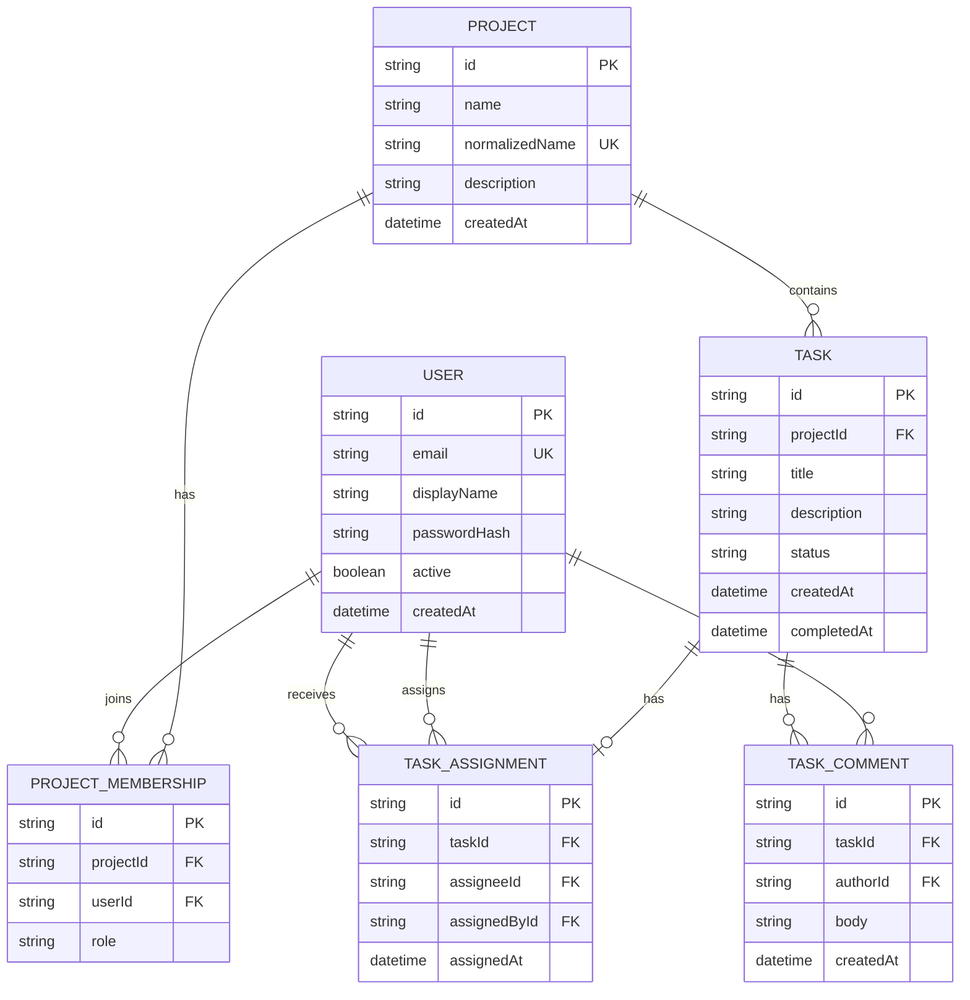

# Matriz - Data Model

## Objective

This document presents the essential data model for the Matriz application MVP, based on the scope defined in requirements, user stories, and constraints. The model is designed to represent only the fundamental entities and relationships that support project and task management.

## Main entities

### User
Represents an account that can access the application.

Main attributes:
- id: unique user identifier
- email: unique login identifier
- displayName: name shown to other project members
- passwordHash: BCrypt password hash
- active: whether the account can sign in or be assigned
- createdAt: account creation date

### Project
Represents an initiative or set of work to organize.

Main attributes:
- id: unique project identifier
- name: project name (3-100 characters)
- normalizedName: trimmed, case-normalized project name used to enforce case-insensitive uniqueness
- description: project description or context (up to 1000 characters)
- createdAt: creation date

### ProjectMembership
Connects a user to a project and defines their project-scoped role.

Main attributes:
- id: unique membership identifier
- projectId: project identifier
- userId: user identifier
- role: MANAGER or MEMBER

### Task
Represents a unit of work associated with a project.

Main attributes:
- id: unique task identifier
- projectId: reference to the owning project
- title: task title
- description: task description
- status: current task status, using the allowed MVP values (backlog, in_progress, review, done, cancelled)
- createdAt: creation date
- completedAt: completion date, when applicable

### TaskAssignment
Records the active assignee for a task and the manager who made the assignment.

Main attributes:
- id: unique assignment identifier
- taskId: task identifier; at most one active assignee per task
- assigneeId: assigned user identifier
- assignedById: manager user identifier
- assignedAt: assignment date

Only active users who are members of the task's project are eligible assignees.

### TaskComment
Represents a comment written on a task by a project member.

Main attributes:
- id: unique comment identifier
- taskId: task identifier
- authorId: comment author identifier
- body: comment text
- createdAt: comment creation date

## Relationships

- A Project can have zero or many Tasks.
- Each Task belongs to exactly one Project.
- Users belong to projects through ProjectMembership.
- A ProjectMembership has one role: MANAGER or MEMBER.
- A Task can have zero or one TaskAssignment.
- A Task can have zero or many TaskComments; each comment has one author.

## Business rules and assumptions

- Each project must have a valid name.
- Project names are trimmed and unique without regard to case.
- New projects are associated with their authenticated creator as the project manager.
- Project reads require membership; project edits and removal require the manager role.
- A project with tasks cannot be removed; the API returns a conflict rather than orphaning dependent records.
- Project listing can be filtered by name; pagination is not defined by the current API contract.
- Each task must have a valid title.
- The task must always belong to an existing project.
- The MVP does not assume user levels, permissions, deadlines, priorities, or comments yet.
- The system must allow task status updates.
- Removing a project or task must require user confirmation.
- A project has project-scoped managers and members for this implementation exercise.
- Managers can manage the project and its tasks, assign tasks, and list eligible project members.
- Members can view/update tasks and add comments, but cannot manage projects or assign tasks.
- Authentication uses a server-side HTTP session for the local implementation exercise; account passwords are persisted only as BCrypt hashes.
- These access, comment, and assignment rules are exercise scope approved by the user; they are not additions to the original product MVP requirements.

## Cardinalities

- Project 1 --- 0..* Task
- Task * --- 1 Project

## Summary model

Project
- id (PK)
- name (3-100 characters)
- normalizedName (unique; trimmed and case-normalized)
- description
- createdAt

User
- id (PK)
- email (unique)
- displayName
- passwordHash
- active
- createdAt

ProjectMembership
- id (PK)
- projectId (FK)
- userId (FK)
- role

Task
- id (PK)
- projectId (FK)
- title
- description
- status
- createdAt
- completedAt

TaskAssignment
- id (PK)
- taskId (FK, unique)
- assigneeId (FK)
- assignedById (FK)
- assignedAt

TaskComment
- id (PK)
- taskId (FK)
- authorId (FK)
- body
- createdAt

## ER diagram in Mermaid

## Compatibility with the API contract

The database model is aligned with [openapi.yaml](../openapi.yaml):
- Project has `id`, `name`, `description`, and `createdAt`.
- Task has `id`, `projectId`, `title`, `description`, `status`, `createdAt`, and `completedAt`.
- The task relationship with the project is represented by `projectId`.
- The task status values match the API enum: `backlog`, `in_progress`, `review`, `done`, `cancelled`.
- User, project-member selection, task-comment, and task-assignment operations are included for this implementation exercise.
- API authentication uses the session cookie issued by `POST /auth/login`; access to projects and tasks is checked against project memberships.
- Project ownership and comment authorship are derived from the authenticated user and are not accepted as client-supplied identity.

## Schema initialization and demo data

`src/main/resources/schema.sql` creates the tables and indexes using idempotent `CREATE ... IF NOT EXISTS` statements. Spring Boot runs this schema before Hibernate validates the entity mappings. It does not drop or recreate existing tables.

The application startup initializer inserts two demo users, two projects, memberships with distinct roles, tasks, an assignment, and a comment only when the corresponding records do not exist. It does not clear or reset application data on later starts. Demo credentials are read from environment variables; only fictitious values are provided in `.env.example`.

The local database is file-backed at `data/matriz` and the test suite uses an in-memory H2 database.

## Consistency with project documentation

This model is consistent with the existing documents:

- [docs/requirements.md](requirements.md): defines project and task management, listing, state updates, and simple search.
- [docs/user-stories.md](user-stories.md): supports project creation, task creation, consultation, removal, and progress tracking.
- [docs/constraints.md](constraints.md): keeps the MVP scope and avoids assuming details that have not yet been confirmed.
- [docs/architecture.md](architecture.md): maintains a modular monolith architecture without introducing unnecessary complexity.

## Final notes

The Project and Task portion represents the documented product MVP. User accounts, project memberships, comments, and assignments are included to satisfy the implementation exercise and the user-approved access scenario; they are exercise scope and should not be treated as confirmed production requirements. Prioritization, labels, change history, deadlines, and integrations remain outside the scope.
