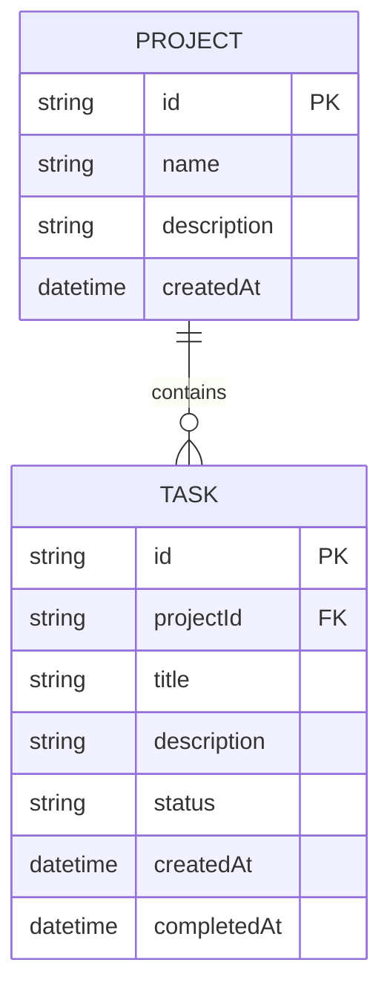

# Matriz - Data Model

## Objective

This document presents the essential data model for the Matriz application MVP, based on the scope defined in requirements, user stories, and constraints. The model is designed to represent only the fundamental entities and relationships that support project and task management.

## Main entities

### Project
Represents an initiative or set of work to organize.

Main attributes:
- id: unique project identifier
- name: project name
- description: project description or context
- createdAt: creation date

### Task
Represents a unit of work associated with a project.

Main attributes:
- id: unique task identifier
- projectId: reference to the owning project
- title: task title
- description: task description
- status: current task status, using the allowed MVP values (backlog, in_progress, review, done, cancelled)
- createdAt: creation date
- completedAt: completion date, when applicable

## Relationships

- A Project can have zero or many Tasks.
- Each Task belongs to exactly one Project.

## Business rules and assumptions

- Each project must have a valid name.
- Each task must have a valid title.
- The task must always belong to an existing project.
- The MVP does not assume user levels, permissions, deadlines, priorities, or comments yet.
- The system must allow task status updates.
- Removing a project or task must require user confirmation.

## Cardinalities

- Project 1 --- 0..* Task
- Task * --- 1 Project

## Summary model

Project
- id (PK)
- name
- description
- createdAt

Task
- id (PK)
- projectId (FK)
- title
- description
- status
- createdAt
- completedAt

## ER diagram in Mermaid

## Compatibility with the API contract

The database model is aligned with [openapi.yaml](../openapi.yaml):
- Project has `id`, `name`, `description`, and `createdAt`.
- Task has `id`, `projectId`, `title`, `description`, `status`, `createdAt`, and `completedAt`.
- The task relationship with the project is represented by `projectId`.
- The task status values match the API enum: `backlog`, `in_progress`, `review`, `done`, `cancelled`.

## Consistency with project documentation

This model is consistent with the existing documents:

- [docs/requirements.md](requirements.md): defines project and task management, listing, state updates, and simple search.
- [docs/user-stories.md](user-stories.md): supports project creation, task creation, consultation, removal, and progress tracking.
- [docs/constraints.md](constraints.md): keeps the MVP scope and avoids assuming details that have not yet been confirmed.
- [docs/architecture.md](architecture.md): maintains a modular monolith architecture without introducing unnecessary complexity.

## Final notes

This model represents the minimum necessary for the Matriz MVP. Details such as users, permissions, prioritization, labels, comments, change history, deadlines, and integrations are outside the scope of the initial model and should be confirmed before any further development.
